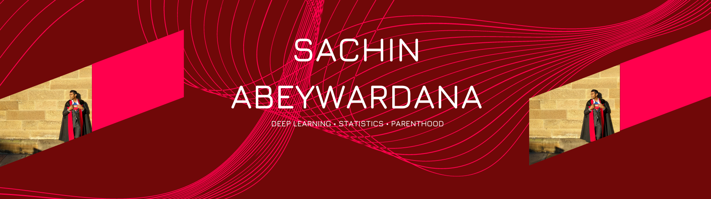

Hello. My name is Sachin and I am a husband and a father of two amazing kids. I am currently a Senior Machine Learning Engineer at Canva and have been working on Deep Learning for the past 10 years. I have trained LLMs and more importantly pushed them into production serving 100s of thousands of requests per day. My obsessions are my two kids and Deep Learning. These are my thoughts. Feel free to get in touch with me on [LinkedIn](https://www.linkedin.com/in/sachinabeywardana/).

## Featured Posts

:::{#pinned-posts}
:::

## All Posts

:::{#all-posts}
:::
